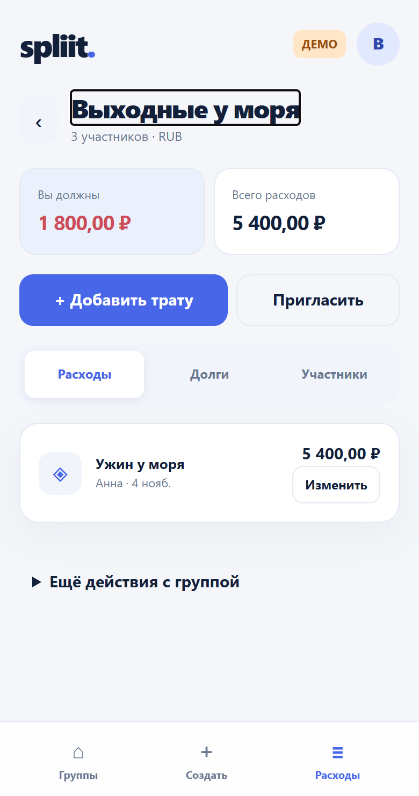
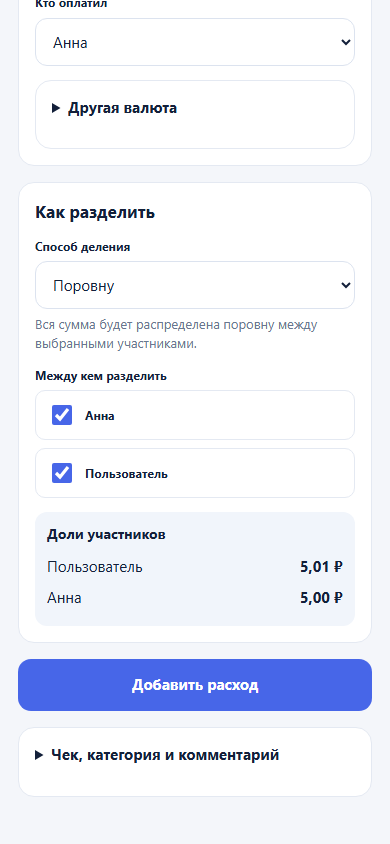
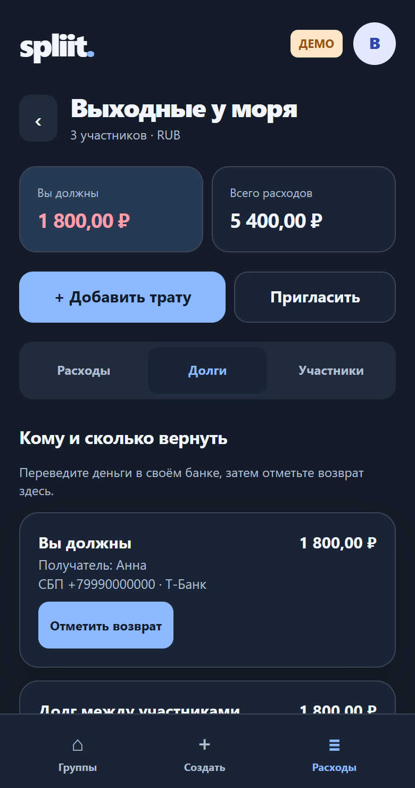

# Spliit UX handoff

Публичная копия фронтенда Spleet для работы над дизайном общих расходов и расчётов. Основа — исходники из коммита 989605af7c44b68c10656a65142a592cbed4dc81. В этой копии используется встроенное браузерное демо с тестовыми данными.

## Как запустить

```sh
npm ci
npm run build
python -m http.server 8000 --bind 127.0.0.1 --directory dist
```

Откройте http://127.0.0.1:8000/ и выберите деморежим.

## Задача для Аргона

Разработайте дизайн Telegram Mini App для новых и постоянных пользователей. Начните с текущих экранов и приложенных снимков. Сохраните существующую логику сумм, распределения и подтверждения возврата. Сравните два варианта входа в группу — история расходов с видимым балансом и расчёты в первом экране.

- Основные сценарии: приглашение и вступление, история группы, добавление траты, выбор плательщика и участников, доли до копейки, кто кому должен, запись возврата.
- Состояния: пустая группа, загрузка, просроченное приглашение, отказ сохранения с сохранением введённых полей, неопределённый результат возврата. Показывайте явное следующее действие.
- Проверьте 320–430 px, светлую и тёмную темы, длинные имена, крупные суммы и управление с клавиатуры. Различайте долги текстом и знаком суммы.
- Итог: запускаемый фронтенд, скриншоты основных сценариев и краткое объяснение решений. Изменения передайте отдельной веткой или патчем.

Браузерное демо использует синтетические данные. Снимки приглашения и восстановления сняты на отдельном локальном тестовом стенде, поэтому браузерное демо может не воспроизвести эти состояния.




